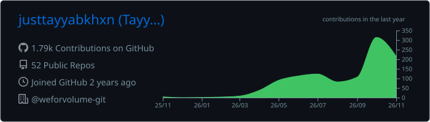
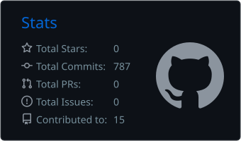
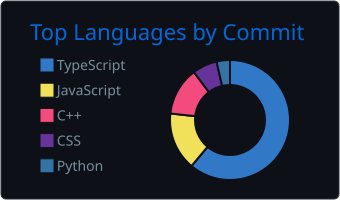
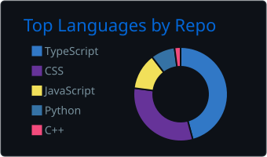
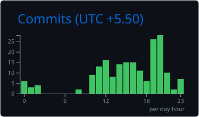

<!-- ═══════════════════════════ HEADER ═══════════════════════════ -->
<p align="center">
  
</p>

<p align="center">
  <a href="https://github.com/justtayyabkhxn">
    
  </a>
</p>

<p align="center">
  <a href="https://linkedin.com/in/justtayyabkhan"></a>
  <a href="https://x.com/justtayyabkhxn"></a>
  <a href="https://reddit.com/user/justtayyabkhan"></a>
  <a href="mailto:tayyabkhangk4734@gmail.com"></a>
  
</p>

<!-- ═══════════════════════════ ABOUT ═══════════════════════════ -->
## 👨‍💻 `~/about-me`

```ts
const tayyab = {
  role:          "Full-Stack Developer",
  building:      "MyBudgetory 💸",
  learning:      ["TanStack Query", "TanStack Router", "TanStack Table"],
  lookingFor:    "Projects to collaborate on 👯",
  askMeAbout:    "Any of my projects 💬",
  reachMe:       "tayyabkhangk4734@gmail.com",
  funFact:       "I write my resume in LaTeX 📝",
} as const;
```

<!-- ═══════════════════════════ STACK ═══════════════════════════ -->
## 🛠️ `~/tech-stack`

<table>
  <tr>
    <td align="right"><sub><b>LANGUAGES</b></sub></td>
    <td>
      
      
      
      
      
      
      
      
    </td>
  </tr>
  <tr>
    <td align="right"><sub><b>FRONTEND</b></sub></td>
    <td>
      
      
      
      
      
    </td>
  </tr>
  <tr>
    <td align="right"><sub><b>BACKEND</b></sub></td>
    <td>
      
      
      
      
    </td>
  </tr>
  <tr>
    <td align="right"><sub><b>DATABASES</b></sub></td>
    <td>
      
      
      
    </td>
  </tr>
  <tr>
    <td align="right"><sub><b>DEVOPS</b></sub></td>
    <td>
      
      
      
      
    </td>
  </tr>
</table>

<!-- ═══════════════════════════ STATS ═══════════════════════════ -->
<!-- Cards below are generated into this repo by .github/workflows/snake.yml -->
## 📊 `~/github-stats`

<p align="center">
  
</p>

<p align="center">
  
  
</p>

<p align="center">
  
  
</p>

<p align="center">
  
</p>

<!-- ═══════════════════════════ SNAKE ═══════════════════════════ -->
## 🐍 `~/contributions --eat`

<p align="center">
  <picture>
    <source media="(prefers-color-scheme: dark)" srcset="https://raw.githubusercontent.com/justtayyabkhxn/justtayyabkhxn/output/github-contribution-grid-snake-dark.svg" />
    <source media="(prefers-color-scheme: light)" srcset="https://raw.githubusercontent.com/justtayyabkhxn/justtayyabkhxn/output/github-contribution-grid-snake.svg" />
    
  </picture>
</p>

<!-- ═══════════════════════════ QUOTE ═══════════════════════════ -->
## 💬 `~/random-dev-quote`

<p align="center">
  
</p>

<!-- ═══════════════════════════ FOOTER ═══════════════════════════ -->
<p align="center">
  
</p>

<p align="center">
  <sub><code>$ exit 0</code> &nbsp;·&nbsp; Thanks for stopping by ✨</sub>
</p>
